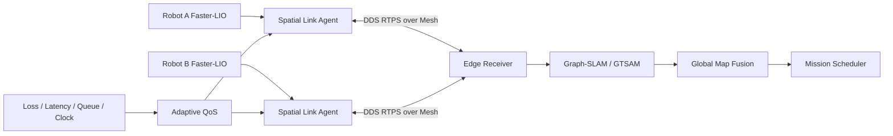

# Swarm Spatial Link

[](https://github.com/zxinyu-robot/swarm-spatial-link/actions/workflows/ci.yml)
[](https://isocpp.org/)
[](LICENSE)

面向多机器人协同定位与地图融合的网络自适应通信中间件核心。

本仓库是多无人机/机器人协同 SLAM 工程的脱敏公开重构，重点展示在 802.11s Mesh/MANET 弱网中，如何根据丢包、时延和队列负载调整 DDS 可靠性、关键帧频率、历史深度、压缩等级与子图传输策略。

> A network-adaptive middleware core for multi-robot spatial state and map fusion.

## 项目亮点

- 定义统一空间消息契约：机器人、会话、序列、源时间、坐标系、不确定度和负载大小。
- 将链路划分为 Healthy、Constrained、Critical 三种模式，并使用连续样本确认防止 QoS 抖动。
- 为位姿、健康度、关键帧和子图生成差异化策略，而不是对所有 DDS Topic 使用同一可靠性。
- 在严重弱网下限制关键帧速率、提高压缩并暂缓子图，避免可靠传输重试形成队头阻塞。
- 使用鲁棒中位数与 MAD 估计节点时钟偏差，支撑 PTP/NTP 降级链路。
- 根据目标频率、不确定度和回环候选强制条件调度关键帧。

## 公开实现

当前仓库包含：

- `AdaptiveQosController`：链路分类、滞回确认和 DDS 策略矩阵。
- `ClockOffsetEstimator`：固定窗口时钟偏差和抖动估计。
- `KeyframeScheduler`：频率门控、不确定度触发和回环候选强制发送。
- `MessageEnvelope`：多机器人空间状态消息契约。
- 弱网回放 Demo、单元测试、链路/边缘节点部署配置和 Linux/macOS CI。

不公开或尚未实现的部分：

- Faster-LIO、GTSAM、Graph-SLAM、POMDP/DQN 算法本体。
- ROS 2/DDS 厂商适配器和真实 802.11s Mesh 配置。
- System V/POSIX 跨进程共享内存实现。
- 实机点云、地图、rosbag、网络抓包与客户场景。

本项目不是完整协同 SLAM 系统，而是其中可独立测试的通信策略与消息契约核心。

## 系统位置



同机点云和关键帧可通过共享内存传递元数据句柄；跨设备链路由 DDS/RTPS 负责发现、QoS 与传输。

## 快速运行

要求：CMake 3.20+、Make、支持 C++20 的编译器。

```bash
cmake --preset default
cmake --build --preset default
ctest --preset default --output-on-failure
./build/default/weak_link_demo
```

演示输出：

```text
adaptive DDS policy replay
  sample=0 mode=healthy keyframe=reliable@10Hz compression=0 defer_submaps=no
  sample=3 mode=constrained keyframe=reliable@5Hz compression=3 defer_submaps=no
  sample=5 mode=critical keyframe=best_effort@2Hz compression=6 defer_submaps=yes
  sample=7 mode=constrained keyframe=reliable@5Hz compression=3 defer_submaps=no
  sample=9 mode=healthy keyframe=reliable@10Hz compression=0 defer_submaps=no
clock offset=5.000ms mad=0.010ms synchronized=yes
keyframes published=6 from 20 frontend updates
```

该回放使用合成网络指标，只验证策略行为，不代表真实无线网络性能。

## 工程案例结果

以下是该公开重构所对应私有工程经历中的结果，不是本仓库 CI 可复现的 benchmark：

- Linux System V/POSIX 共享内存传输关键帧，相较 ROS 2 Topic 序列化，相关链路 CPU 占用降低约 `35%–50%`。
- 弱网 DDS QoS 治理后，关键帧丢帧率降低约 `20%–40%`。
- Jetson Orin/RK3588 端实现约 `10–20 Hz` 关键帧同步。
- 多机子图融合端到端延迟约 `100–300 ms`。
- PTP 用于微秒级主同步，NTP 作为毫秒级降级方案。
- 在桥梁巡检、河道巡检无/弱 GPS 与电磁干扰仿真场景中验证通信和状态共享链路。

这些数据依赖原始硬件、地图、rosbag、网络拓扑和完整 ROS 2 集成。指标口径见 [benchmark 方法](docs/benchmark-methodology.md)。

## 项目结构

```text
include/swarm_spatial_link/
  message_contract.h
  adaptive_qos.h
  clock_offset_estimator.h
  keyframe_scheduler.h
src/
  adaptive_qos.cpp
  clock_offset_estimator.cpp
  keyframe_scheduler.cpp
  weak_link_demo.cpp
config/
  link_policy.yaml
  deployment.yaml
docs/
  architecture.md
  benchmark-methodology.md
```

## 下一步

1. 增加 Fast DDS/Cyclone DDS QoS 适配器与 ROS 2 diagnostics 输入。
2. 增加 POSIX 共享内存 loan/lease 生命周期和崩溃恢复。
3. 增加网络故障注入、pcap 指标导入和可重复 rosbag 回放。
4. 增加子图版本、乱序补偿和 Graph-SLAM 事务接口。
5. 将规则策略作为 POMDP/DQN 调度器的安全基线。

## License

[MIT](LICENSE)
